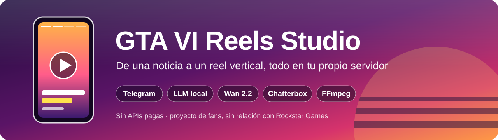
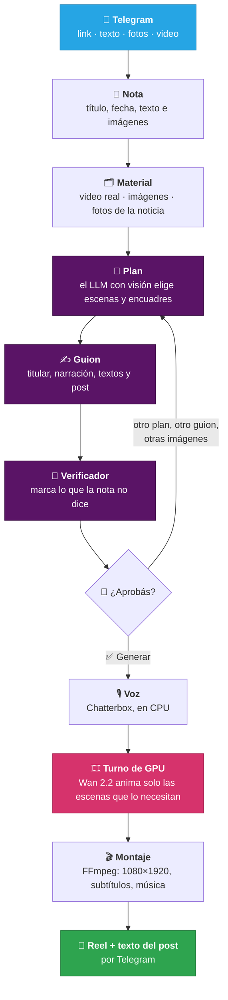
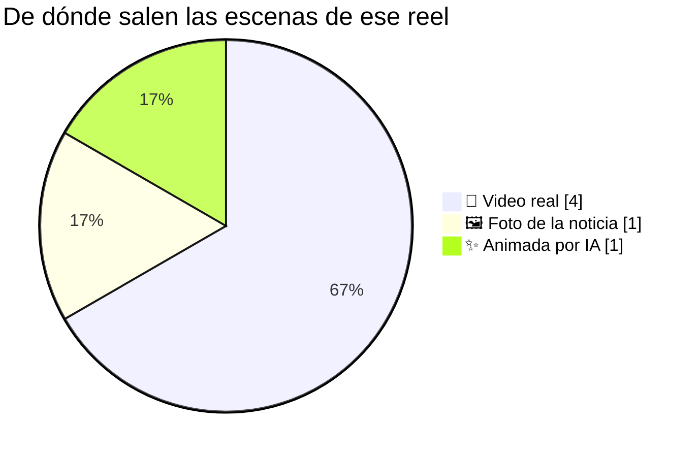
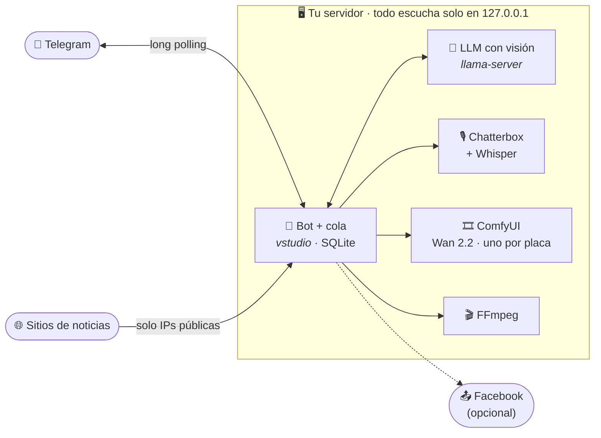
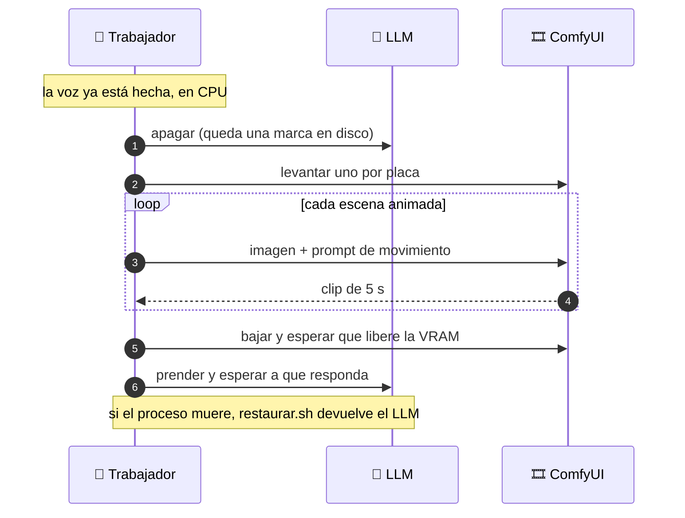
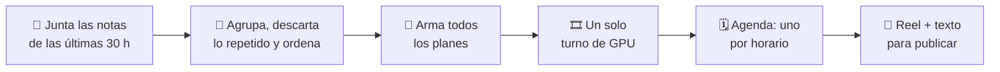
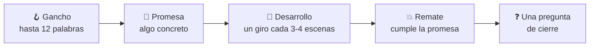

<p align="center">
  
</p>

<p align="center">
  
  
  
  
  
  
</p>

<p align="center">
  <a href="#-qué-hace">Qué hace</a> ·
  <a href="#-cómo-se-arma-un-reel">Cómo se arma un reel</a> ·
  <a href="#-qué-necesitás">Qué necesitás</a> ·
  <a href="#-puesta-en-marcha">Puesta en marcha</a> ·
  <a href="#-uso-desde-telegram">Uso</a> ·
  <a href="#-lo-que-aprendimos">Lo que aprendimos</a>
</p>

Un bot privado de Telegram que convierte una noticia de GTA VI en un reel vertical listo para publicar, generado
**entero en tu propio servidor**: un LLM local escribe el guion, Wan 2.2 anima las imágenes, Chatterbox pone la
voz y FFmpeg hace el montaje.

*A private Telegram bot that turns a GTA VI news link into a ready-to-post vertical reel, fully self-hosted:
local LLM (Qwen) for planning and script, Wan 2.2 image-to-video, Chatterbox TTS and FFmpeg. Code, comments and
bot messages are in Spanish.*

> [!NOTE]
> **Qué es y qué no es.** Es el código de un sistema que funciona todos los días en un servidor con 2 × RTX 3090.
> No es un producto llave en mano: no trae instalador, las rutas suponen `~/video-studio/` y vas a tener que
> adaptar los scripts de `scripts/` a tu forma de correr el LLM y ComfyUI. Se publica porque el flujo, los
> chequeos y lo que se midió le pueden servir a alguien más.

> [!IMPORTANT]
> **No trae material del juego**: ni imágenes, ni tráilers, ni música. Es un proyecto de fans, sin relación con
> Rockstar Games ni Take-Two Interactive.

## 🎬 Qué hace

Le mandás un link y te devuelve un plan para aprobar. Cuando lo aprobás, arma el reel y te lo manda con el texto
para publicar.



Además de la noticia a pedido:

| | Función | En una línea |
|:-:|---|---|
| 🤖 | **Reels automáticos** | Todos los días junta las noticias, descarta las repetidas y arma un reel de cada una |
| 🗓️ | **Agenda** | Los automáticos llegan repartidos en el día, uno por horario |
| 🧩 | **Formatos** | Noticia, «¿sabías que…?», ranking y antes-y-ahora |
| ✂️ | **Edición por chat** | «sin subtítulos», «otro guion», «cambiá la escena 3»… sin volver a generar todo |
| 🎥 | **Biblioteca de video real** | Corta tus videos en tomas y el LLM anota qué se ve en cada una |
| 📤 | **Facebook** (opcional) | Programa solo los reels que pasan el control de calidad |

## 🧱 Cómo se arma un reel

Cada escena sale de una de tres fuentes. Solo una usa la GPU:

| | Medio | De dónde sale | GPU | Tiempo |
|:-:|---|---|:-:|---|
| 🎥 | `toma` | Un tramo de **video real** de tu biblioteca, recortado a 9:16 | no | segundos |
| 🖼️ | `foto` | Una **foto con paneo**: las de la noticia, o una imagen chica para animar | no | segundos |
| ✨ | `ia` | Una imagen **animada por Wan 2.2** (5 s) | sí | ~8 min |

Un reel real de 29 segundos, escena por escena:

| Escena | 1 | 2 | 3 | 4 | 5 | 6 |
|---|:-:|:-:|:-:|:-:|:-:|:-:|
| **Medio** | 🎥 | 🎥 | 🖼️ | 🎥 | 🎥 | ✨ |
| **Qué es** | video real | video real | foto de la noticia | video real | video real | animada por IA |
| **Imágenes distintas** | 4 | 2 | 2 | 3 | 3 | 2 |

Dentro de cada escena la imagen cambia cada ~3 segundos: ese reel muestra **16 tomas** y solo necesitó
**8 minutos de GPU**.



### Las piezas en el servidor



### El turno de GPU

El LLM y Wan no entran juntos en la memoria de las placas, así que se turnan. El LLM vuelve siempre, aunque algo
falle:



- Política **`inactivo`** (por defecto): se genera cuando el LLM lleva `inactividad_min` sin uso. Se miran las
  métricas de `llama-server` y, si configurás `[gpu] sesiones_app`, la carpeta donde otra aplicación que usa el
  mismo LLM guarda sus sesiones. Política **`inmediato`**: se genera apenas hay algo aprobado.
- Durante el turno se escribe la marca `data/turno_gpu.json`. Si el proceso muere, el próximo ciclo y el
  `ExecStopPost` del servicio (`scripts/restaurar.sh`) devuelven el LLM. Si estaba apagado antes, se deja apagado.
- A mano: `python -m vstudio restaurar` (no actúa si el turno sigue vivo).

## 🧰 Qué necesitás

| | Pieza | Para qué | |
|:-:|---|---|:-:|
| 🐧 | **Linux** con `systemd` de usuario, **Python 3.12+**, **FFmpeg** | La base | obligatorio |
| 🟩 | **GPU NVIDIA de 24 GB** (una o más) | Animar con Wan 2.2: un ComfyUI por placa | obligatorio |
| 🧠 | **LLM con visión** servido por `llama-server` en `127.0.0.1:8080` | Plan, guion y verificación | obligatorio |
| 🎞️ | **ComfyUI 0.44** con Wan 2.2 I2V 14B | Imagen a video | obligatorio |
| 🎙️ | **Chatterbox Multilingual** + `faster-whisper` | Voz, subtítulos y control de pronunciación | obligatorio |
| 📱 | **Bot de Telegram** (token de @BotFather) | Manejarlo todo | obligatorio |
| 🔍 | **SearXNG** local (`127.0.0.1:8888`) | Buscar fotos de la noticia | opcional |
| 🎵 | **ACE-Step 1.5** | Música de fondo propia | opcional |
| 🗣️ | **Qwen3-TTS** | Voz alternativa | opcional |
| 📖 | Diccionario **`hunspell-es`** | Control de ortografía | opcional |

Sin una pieza opcional, esa parte no corre y lo demás sigue.

<details>
<summary><b>Detalle de los modelos</b></summary>

- **LLM**: acá se usa un Qwen de 27B con visión, con API compatible con OpenAI y la clave en un archivo.
  `scripts/qwen.sh` lo apaga y lo prende con `docker stop|start llm-server`: si lo corrés de otra forma, ese
  script es lo que hay que cambiar.
- **Wan 2.2**: I2V 14B en fp8 (alto y bajo ruido), el LoRA LightX2V de 4 pasos, el codificador `umt5_xxl` y el
  VAE de Wan 2.1. Los nombres exactos de los archivos están en `workflows/wan/wan22_i2v_14b.api.json`.
- **Cuadros intermedios** (opcional): `rife_v4.25.safetensors` en `ComfyUI/models/frame_interpolation`. Wan
  entrega 16 cuadros por segundo; con esto el clip sale a 30 y no se ve entrecortado al lado del video real.
- **Chatterbox** va en su propio venv (`~/video-studio/tts-cb`), que también trae `faster-whisper`.

</details>

<details>
<summary><b>Estructura de carpetas en el servidor</b></summary>

| Ruta | Qué es |
|---|---|
| `~/video-studio/app/` | este repo (`vstudio/`, `scripts/`, `workflows/`) + `.venv` |
| `~/video-studio/config.toml` | tu configuración (ver `config.example.toml`); todo es opcional |
| `~/video-studio/ComfyUI/` | ComfyUI + modelos de Wan 2.2 |
| `~/video-studio/tts-cb/` | Chatterbox + faster-whisper en su venv |
| `~/video-studio/assets/` | `fonts/`, `voz/`, `musica/`, `biblioteca/` (imágenes), `tomas/` (video real), `diccionario/` |
| `~/video-studio/proyectos/<id>/` | imágenes, recortes, clips, voz, reel y logs de cada proyecto |
| `~/video-studio/data/` | `studio.db` (SQLite), marca del turno de GPU, estado de la agenda |
| `~/video-studio/secrets/` | token del bot, usuarios vinculados, código de vinculación (700/600) |

</details>

## 🚀 Puesta en marcha

```bash
git clone https://github.com/skyvanguard/gta-vi-reels-studio ~/video-studio/app
cd ~/video-studio/app
python3 -m venv .venv && .venv/bin/pip install -e ".[dev]"
.venv/bin/python -m pytest -q                      # los tests no necesitan GPU ni modelos
cp config.example.toml ~/video-studio/config.toml   # y poné tu zona_horaria
```

1. En Telegram, hablale a **@BotFather**: `/newbot`. Después `/setjoingroups` → Disable (el bot es solo para
   chats privados).
2. Guardá el token directo en el servidor (no lo pegues en ningún chat):
   ```bash
   mkdir -p ~/video-studio/secrets && chmod 700 ~/video-studio/secrets
   (umask 077; read -rsp "token: " T && printf '%s' "$T" > ~/video-studio/secrets/telegram_token)
   ```
3. Instalá y arrancá el servicio:
   ```bash
   mkdir -p ~/.config/systemd/user
   cp ~/video-studio/app/deploy/video-studio.service ~/.config/systemd/user/
   systemctl --user daemon-reload && systemctl --user enable --now video-studio
   ```
4. Vinculá tu cuenta: `cat ~/video-studio/secrets/codigo_vinculacion` y mandale al bot `/vincular CODIGO`. El
   código sirve una sola vez y vence a las 24 h. Para sumar a otra persona: `python -m vstudio vincular`.
5. Voces: `python -m vstudio voces` prepara las voces; por Telegram, `/voces` y `/voz NOMBRE`.

### El material del juego lo ponés vos

El repo no trae nada de Rockstar. Lo que uses lo bajás vos y lo usás bajo tu responsabilidad.

| | Qué | Dónde va | Cómo entra |
|:-:|---|---|---|
| 🖼️ | **Imágenes oficiales** | `assets/biblioteca/rockstar/` | Los paquetes que Rockstar publica en <https://www.rockstargames.com/VI/media> |
| 🎥 | **Video real** | `assets/tomas/` | `python -m vstudio tomas VIDEO --fuente NOMBRE [--tema TEMA]`, o un video de hasta 20 MB por Telegram con `/biblioteca TEMA` |
| 📷 | **Tus fotos** | `assets/biblioteca/editor/` | `/biblioteca TEMA` con una o varias fotos |

Al cortar un video en tomas se detectan los cortes y las franjas negras, y se descarta lo oscuro y lo repetido.
Las imágenes se etiquetan por su carpeta y su nombre, y eso se le dice al LLM, que solo no reconoce a los
personajes.

> [!WARNING]
> La política de Rockstar sobre su material está pensada para el uso de fans no comercial, y una plataforma
> puede reconocer y reclamar el material de un tráiler. Tenelo en cuenta si pensás monetizar.

## 💬 Uso desde Telegram

Mandá un **link**, un texto y/o **fotos** (también como álbum). Llega el storyboard y el plan con botones:

> ✅ Generar · 🔁 Otro plan · 🔊 Voz · 💬 Subtítulos · 🔥 Titular · 🖼️ Otras imágenes · ✍️ Otro guion · ❌ Cancelar

El reel entregado trae los mismos botones: voz, subtítulos y titular se rearman **sin GPU**.

| Querés… | Escribí |
|---|---|
| Un reel de una noticia | el link (y, si querés, «que dure 1 min») |
| Animar tus fotos | las fotos; con «solo video» sale la animación sin voz ni textos |
| Otro formato | «sabías que…», «ranking» o «antes y ahora» en el mensaje |
| Cambiar algo del último reel | «sin subtítulos», «sin voz», «otras imágenes», «otro guion», «que dure 30 s» |
| Cambiar una sola escena | «cambiá la escena 3» o `/escena 3` |
| Usar tu propio guion | pegalo con secciones o tiempos: «[INTRO – 0:00 a 0:10]» |

<details>
<summary><b>Todos los comandos</b></summary>

| Grupo | Comandos |
|---|---|
| **Editar el plan** | `/gancho N` · `/reescribir` · `/titular TEXTO` · `/texto N TEXTO` · `/narracion N TEXTO` · `/post TEXTO` |
| **Largo** | `/largo 10\|15\|30\|75\|90` (75 y 90 pasan del minuto) |
| **Cola y GPU** | `/estado` · `/ya` (apaga el LLM y genera ahora) · `/politica inactivo\|inmediato` |
| **Después de entregar** | `/regenerar ID N` (otra semilla para una escena animada) · `/revoz ID` · `/reescribir ID` · `/cancelar ID` |
| **Una escena** | `/escena N` (otra toma de video real) |
| **Voz** | `/voces` · `/voz NOMBRE` · nota de voz de 10-20 s con `/voz_nueva NOMBRE` (solo tu voz o la de alguien que te dé permiso) |
| **Biblioteca** | `/biblioteca TEMA` con fotos o un video · `/biblioteca` · `/tomas` |
| **Automático** | `/auto` · `/auto ya` · `/auto off` · `/auto on` |
| **Agenda** | `/agenda` · `/agenda ya` · `/agenda off` · `/agenda on` |

</details>

## 🤖 Reels automáticos y agenda

Todos los días a la hora configurada (`[automatico] hora`, 05:00 por defecto, en tu `zona_horaria`):



- **Fuentes** (`vstudio/noticias.py`): Bing Noticias en español e inglés, 3DJuegos, Vandal, Eurogamer.es, IGN,
  GamesRadar y VGC.
- Descarta lo publicado en los últimos 10 días y lo que no es de GTA VI.
- Si una nota no se puede leer, prueba otro medio que cuente lo mismo. Sin el texto de la nota no arma nada.
- Hasta la mitad de la tanda sale en otro formato, para que no tengan todos el mismo molde.
- **Agenda** (`vstudio/agenda.py`): en lugar de llegar todos juntos, llegan de a uno en los horarios de
  `[agenda] horarios`.

<details>
<summary><b>Publicación en Facebook (opcional)</b></summary>

`vstudio/facebook.py` usa la Reels Publishing API de Meta: sube el reel y lo deja programado, marcado como hecho
con IA. Hace falta una app de Meta con los permisos `pages_show_list`, `pages_read_engagement` y
`pages_manage_posts`, en modo Live. Si Meta no te da ese acceso, el sistema funciona igual: los reels llegan por
Telegram y se publican a mano. `python -m vstudio facebook` guarda el token de la página (el de usuario no queda
en ningún lado).

`vstudio/publicador.py` solo programa los reels automáticos que pasan el control de `calidad.py`. Lo frenan:
datos sin respaldo o sin verificar, ortografía, pronunciación dudosa, imágenes o encuadres repetidos y lo que el
LLM ve deforme en un cuadro de cada clip. Si un control no pudo correr, también frena.

</details>

## ⏱️ Números medidos

Con 2 × RTX 3090:

| | Paso | Tiempo |
|:-:|---|---|
| 🧠 | Plan (bajar la nota + LLM con imágenes) | ~2 min |
| ✍️ | Guionista (15 escenas) | 1,5-4 min por intento |
| ✨ | Clip de 720×1280, 5 s, Wan 2.2 14B + LoRA de 4 pasos | 435-486 s · pico de 21-23 GB de VRAM |
| 🌊 | El mismo clip con cuadros intermedios (161 cuadros a 30 por segundo) | ~18 s más |
| 🎞️ | 15 clips (reel de 76 s) con las 2 placas | 58,5 min |
| 🎥 | Escena de video real o de foto | segundos, sin GPU |
| 🔁 | El LLM vuelve a estar listo | ~10 s |

## 💡 Lo que aprendimos

| | Lección | El dato |
|:-:|---|---|
| 🎥 | **Mostrar video real cambia más que mejorar la IA** | Con todas las escenas animadas desde las mismas fotos, los reels parecían una presentación de diapositivas. Mezclar tomas reales, fotos y alguna animación fue el cambio más grande. |
| 🔍 | **Lo que entra blando a Wan sale blando** | Estirar una foto chica antes de animarla da un clip borroso que cuesta lo mismo que uno bueno. `vstudio/imagenes.py` limita el estirado a 1,25×. |
| 📐 | **Subir la resolución ayuda poco para lo que cuesta** | 864×1536 dio +41 % de nitidez en un primer plano y +7 % en un plano general, con 1,7× de tiempo y la VRAM al límite. |
| 🪜 | **Más pasos no dieron más nitidez** | El LoRA de 4 pasos con 8 pasos dio lo mismo. Sin LoRA (20 pasos) tardó 9 veces más y salió peor. |
| 📅 | **El LLM cuenta mal los días** | La cuenta regresiva se calcula en código (`vstudio/fechas.py`) y se le pasa hecha. |
| 🗣️ | **Los TTS en español latino pronuncian mal el voseo** | El guion va en tú, y Whisper escucha cada escena sin ver el texto: si una palabra no se oye bien, se vuelve a generar. |
| 📋 | **Los ejemplos del prompt se copian** | Un prompt con «pero ojo» de ejemplo dio guiones con «ojo» tres veces. Las reglas se chequean en código. |

<details>
<summary><b>Criterio de guion: cómo se escribe y qué se mide</b></summary>

El guion lo escribe un paso aparte (`vstudio/guionista.py`): el plan con imágenes reparte las escenas y el
guionista, sin imágenes y con razonamiento, escribe lo que se dice y lo que se lee.

**Cómo suena**: un fan contándole la noticia a un amigo, no una lista de datos. Un hilo, pocos datos bien
contados con su consecuencia para el que mira, frases completas con ritmo variado, palabras de todos los días.

**Estructura**:



**Se mide en cada guion** (si falla, el guionista lo corrige con el motivo, hasta 3 intentos): gancho largo o con
saludo, escenas fuera de 9-21 palabras, cierre sin pregunta, escenas de relleno, cebo de interacción, muletillas
repetidas, la misma frase en 3 escenas o más, anglicismos y jerga de nota de prensa.

**Verificación** (`vstudio/verificador.py`): una pasada aparte compara el guion con la nota y lista lo inventado.
No cambia el guion: lo pone primero en la advertencia del plan.

</details>

## 🛠️ Operación

```bash
cd ~/video-studio/app
systemctl --user status video-studio          # estado del servicio
journalctl --user -u video-studio -f          # logs del servicio
tail -f ~/video-studio/logs/vstudio.log       # log propio (rotativo)
.venv/bin/python -m vstudio estado            # proyectos activos
.venv/bin/python -m vstudio planificar --texto "https://..."   # plan sin Telegram
.venv/bin/python -m vstudio aprobar ID && .venv/bin/python -m vstudio procesar --esperar
.venv/bin/python -m vstudio tomas             # resumen de la biblioteca de video real
.venv/bin/python -m pytest -q                 # tests
```

## 🔒 Seguridad

| | Qué | Cómo |
|:-:|---|---|
| 🚪 | **Sin puertos nuevos** | Telegram va por long polling; ComfyUI y el LLM escuchan solo en 127.0.0.1 |
| 👤 | **Solo usuarios vinculados** | El bot atiende chats privados de quien se vinculó; a los demás no les responde |
| 🌐 | **Descargas acotadas** (`vstudio/red.py`) | Solo http/https a 80/443, sin proxies del entorno, bloquea IPs internas en cada salto y verifica la IP real después de conectar; topes de tamaño y de tiempo |
| 🎞️ | **Videos de entrada** | FFmpeg limitado a archivos locales y a contenedores conocidos |
| 🔑 | **Token** | Nunca se loguea y se borra de los mensajes de error |

> [!TIP]
> Si el usuario del servicio puede manejar Docker (para apagar y prender el LLM), una falla en una librería que
> procesa una nota maliciosa equivale a root. Conviene darle solo `docker stop/start llm-server` por sudoers.

## 📄 Licencia y avisos

- El **código** de este repo se publica bajo licencia **MIT** (ver [`LICENSE`](LICENSE)).
- **Grand Theft Auto**, **GTA VI** y **Rockstar Games** son marcas de Take-Two Interactive. Este proyecto no
  tiene relación con ellas y no incluye material suyo.
- Cada modelo tiene su licencia (Wan 2.2, Chatterbox, Whisper, ACE-Step, Qwen): revisala antes de usarlo, sobre
  todo para un uso comercial. Las muestras de voz de las demos no traen una licencia clara para publicar.
- Las imágenes de las notas son de terceros.
- Facebook pide marcar los videos realistas hechos con IA; el publicador lo hace.
